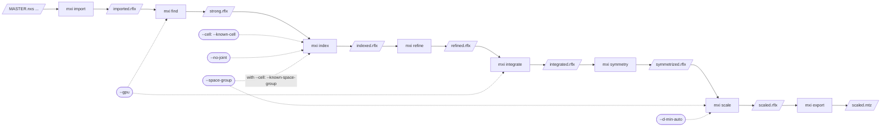
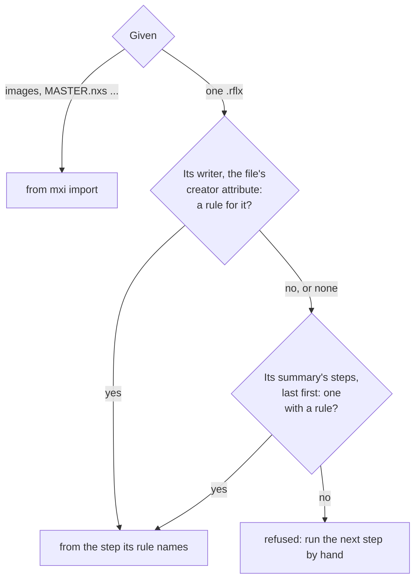
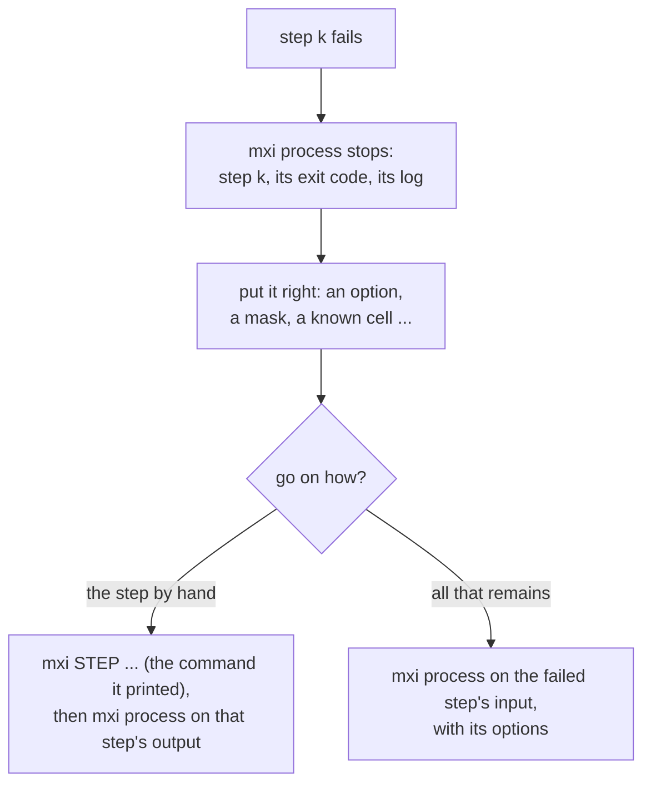
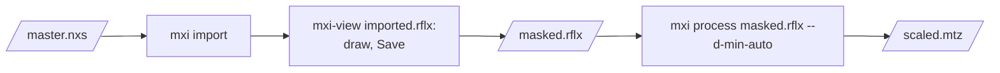
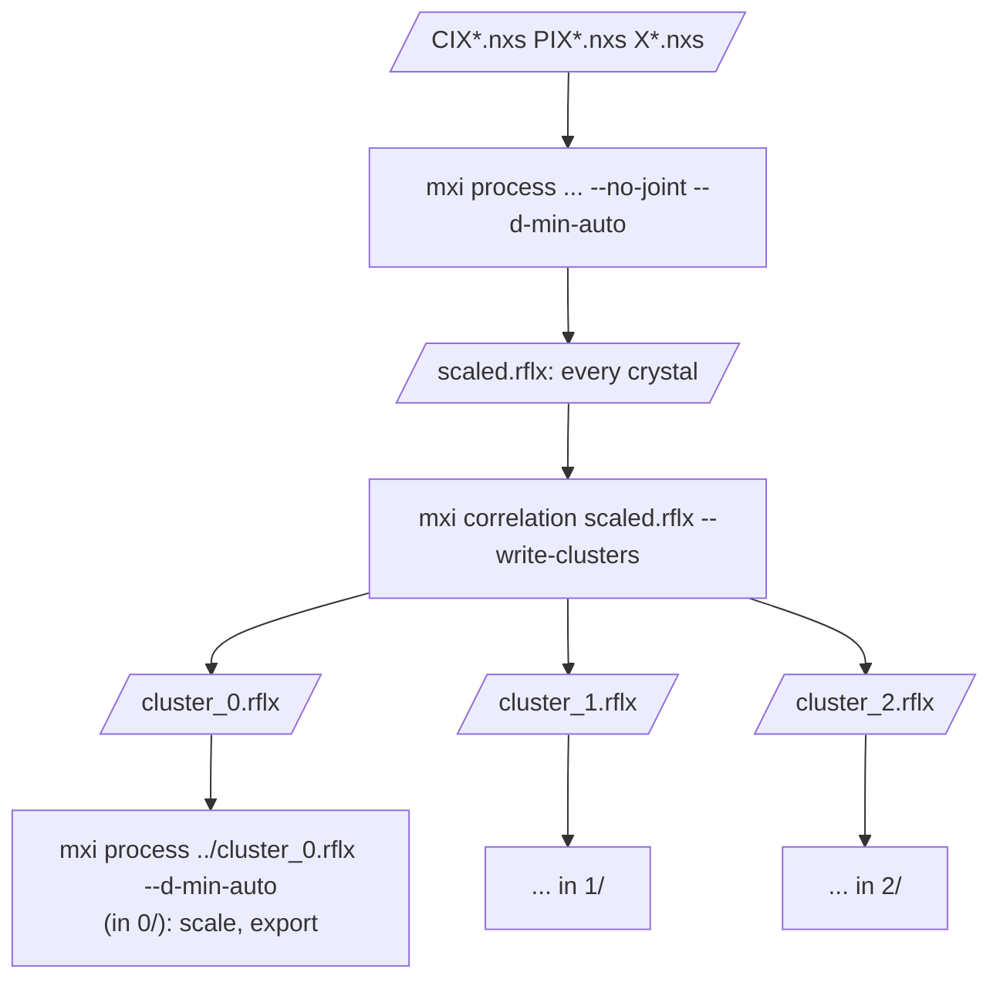

# mxi process: the whole sequence, a step at a time

`mxi process` runs mxi's eight steps in turn -- import, find, index, refine,
integrate, symmetry, scale, export -- each the command a script of them would
run, on the file the step before wrote, with its own output and log. It is for
routine data: complete, well-described images that need no more than the
options below. Data that need more are processed a step at a time, and
`mxi process` can take over again from any step's file.

```sh
mxi process master.nxs --gpu -j 8 --d-min-auto
mxi process master.nxs --cell 78,78,78,90,90,90 --space-group I213
mxi process CIX*.nxs --no-joint --d-min-auto     # several crystals, a sweep each
mxi process strong.rflx -j 8                     # from the step after the file's
mxi process master.nxs --dry-run                 # the commands, printed, none run
```

## The sequence, and where each option goes

Each step is the command it names, called in this process with the arguments
it would have had typed, `mxi STEP ...` -- its own output, its own log, and
nothing different from running it by hand; until 7 November each was a process
of its own. A step that fails says so and stops the run with the message
below; a step that crashes takes the run with it, without that message (the
price of no process starting another, which makes the code simpler and a
Windows build nearer: docs/windows.md).



| Option | Goes to | As |
| --- | --- | --- |
| `-j N` | every step | `-j N` |
| `--gpu` | find, integrate | `--gpu` |
| `--cell a,b,c,α,β,γ` | index | `--known-cell` |
| `--space-group NAME` | scale; and index where `--cell` is given | `--space-group`; `--known-space-group` (the known cell's setting, meaningless alone) |
| `--no-joint` | index | `--no-joint`: several sweeps, each a crystal indexed on its own |
| `--d-min-auto` | scale | `--d-min-auto`: the resolution limit from CC½ |
| `--dry-run` | -- | the commands printed, none run |

Each step's header says which it is and its command, `== mxi process: step 3 of
8: mxi index strong.rflx -j 8`, and its output follows. `mxi_process.log` keeps
`mxi process`'s own lines -- the headers, its notes, a failure -- and each step
its own log as ever, `mxi_index.log` and the rest.

## Where it starts

Given images, it starts from import. Given one `.rflx`, it starts from the step
after the one that wrote the file, that file the first step's input; the
options of the steps before are said to be unused.



| Written by | Goes on from | Why |
| --- | --- | --- |
| `mxi import` | find | |
| `mxi find` | index | |
| `mxi index` | refine | |
| `mxi refine` | integrate | |
| `mxi integrate` | symmetry | |
| `mxi symmetry` | scale | |
| `mxi scale` | export | |
| `mxi correlation` | scale | a cluster (`--write-clusters`): a subset of the crystals, scaled afresh |
| `mxi untrusted` | find | untrusted regions change the pixels finding and integration use: no step before stands, whatever file was masked (`docs/mask.md`) |

The writer decides, not the summary's last step: a cluster carries its
crystals' history, scaling's among it, yet must be scaled again. Where the
writer has no rule -- `mxi split`, `mxi combine` -- the summary is walked back to
the last step that has one. It says what it went by:

```
mxi process: masked.rflx: after mxi_untrusted, which wrote it -- from mxi find on
mxi process: --cell not used: its step is done already
```

## When a step fails

A step that fails stops it, at once: which step, its exit code, where its
output is, and how to go on. `mxi process` exits with the step's code (1 where
it could not start a step or tell where to begin, 2 for a mistake in its own
options).



```
mxi process: stopped at step 3 of 8, mxi index, which failed (exit 1): its
output is above, and in mxi_index.log. Once it is put right, run it again --
  mxi index strong.rflx -j 8
-- and the steps after it, or all that remains:
  mxi process strong.rflx -j 8
```

The step by hand is the way for what `mxi process` does not carry: an option
for one step alone (`mxi index strong.rflx --max-lattices 2`), then `mxi
process indexed.rflx` for the rest.

## Ways through

One crystal, routine:


A shadow on the detector first (`docs/mask.md`):



Many crystals, then those that belong together
(`docs/tutorials/cows-pigs-people.md`, `docs/correlation.md`):



Each cluster carries its own crystals' history, cut from the whole run's
(`docs/rflx.md`), so that its report is its crystals'.

## What it is not

Not a way to pass options to one step: `mxi process` carries the few above
and no more, by design -- for anything else, the step by hand, then `mxi
process` on its output. Not mxi-ui: the interface runs the same commands a step
at a time, each shown and changeable before it runs (`docs/ui.md`). Its source
is `apps/mxi_process.cc`; its tests, `python/tests/test_process.py`, try its
rules with `--dry-run` -- images, a step's file, a cluster, a masked file, the
summary walked back, a refusal -- and real runs that stop.
